<p align="center">
  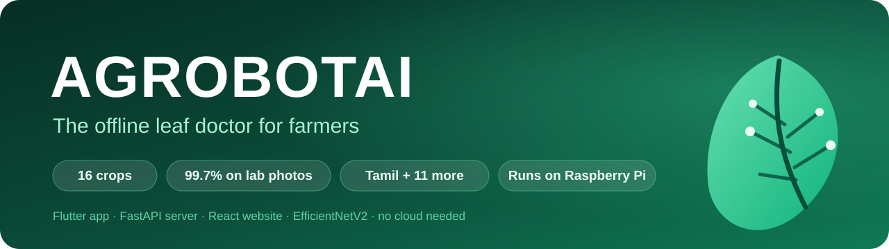
</p>

<p align="center">
  <a href="https://github.com/Achu226/agrobotai/releases/latest"></a>
  <a href="https://github.com/Achu226/agrobotai/releases"></a>
  <a href="LICENSE"></a>
  <a href="https://github.com/Achu226/agrobotai/stargazers"></a>
</p>

<p align="center">
  
  
  
  
  
  
</p>

<h3 align="center">Photograph a leaf. Get the disease, what to do, and when it is safe to spray —<br>in Tamil, offline, on the farm's own Wi-Fi.</h3>

<p align="center">
  <a href="https://github.com/Achu226/agrobotai/releases/latest"><b>⬇️ Download the app</b></a> ·
  <a href="#-quick-start"><b>🚀 Quick start</b></a> ·
  <a href="#-how-it-works"><b>🧠 How it works</b></a> ·
  <a href="#-accuracy"><b>📊 Accuracy</b></a> ·
  <a href="https://github.com/Achu226/agrobotai/issues/new?template=using-agrobotai.yml"><b>🙋 Tell us you use it</b></a>
</p>

<p align="center">
  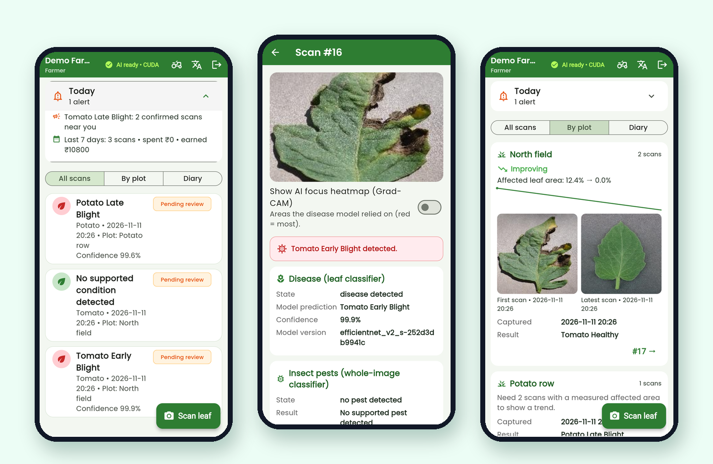
</p>

---

## ✨ Why AGROBOTAI

Most crop-doctor apps need fast internet and send your photos to a company's cloud. AGROBOTAI runs **on a laptop or a
₹5,000 Raspberry Pi in the farmhouse**: the phone talks to it over Wi-Fi, photos never leave the farm, and it keeps
working when the mobile signal does not. It is **honest when unsure** — below its confidence gate it says
*"not sure, take another photo"* instead of guessing.

## 🌾 Features

<table>
<tr>
<td width="50%" valign="top">

### 🔬 Diagnose
- **48 diseases, 16 crops** — tomato, potato, pepper, rice, banana, maize, grape, apple, orange and more
- **9 insect pests** + "no pest" (pest model trained separately)
- **Calibrated confidence** and a "not a supported crop" answer — never a forced guess
- **Plant name only when sure** (≥ 90 % for that crop) · **3-photo scan** of one plant for a steadier answer
- **AI focus heatmap** (Grad-CAM) and **affected-area %**
- Advice in **Tamil, English and 10 more Indian languages**, voice questions, offline AI chat

</td>
<td width="50%" valign="top">

### 🗓️ Plan
- **Today card** — spray now?, reminders due, alerts, last 7 days
- **Spray planner** from the real hourly forecast (rain, wind, heat)
- **Spray dose calculator** with the **harvest-safe date**
- **Fertilizer bags** from the Soil Health Card N-P-K
- **Crop calendar** — sowing date → dated tasks as phone reminders (10 crops)
- **Mandi prices** (Agmarknet) and **Kisan Call Centre** on every result

</td>
</tr>
<tr>
<td width="50%" valign="top">

### 📈 Track
- **Recovery tracker** per plot with **before / after photos**
- **Farm diary** with repeating reminders and **voice notes**
- **Profit book** — spent, earned, profit per plot, *where the money goes*
- **Excel export** of diary and scans for the bank or officer

</td>
<td width="50%" valign="top">

### 📡 Connect
- **Disease alerts near you** — what other farmers confirmed in your village (counts only)
- **Ask an expert** — send an unsure scan to the agriculture officer; the answer comes back in the app
- **IoT soil and weather sensors** on the Raspberry Pi, with phone alerts
- **Offline queue** — scans taken without signal upload later; **offline guide**
- **Home-garden mode** for pots and terraces · **admin outbreak dashboard**
- **Pi farm Wi-Fi** — no router in the field? The Pi makes its own Wi-Fi · daily **USB backup**

</td>
</tr>
</table>

## 📱 Screenshots

<table>
<tr>
<td align="center">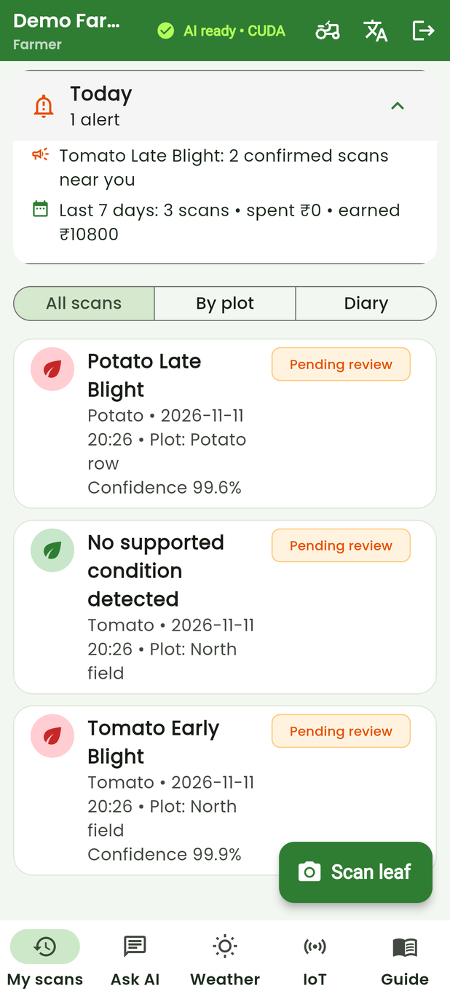<br><sub><b>Today</b> at a glance</sub></td>
<td align="center">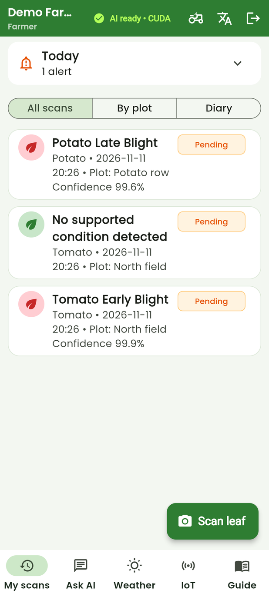<br><sub><b>Scan result</b> with confidence</sub></td>
<td align="center">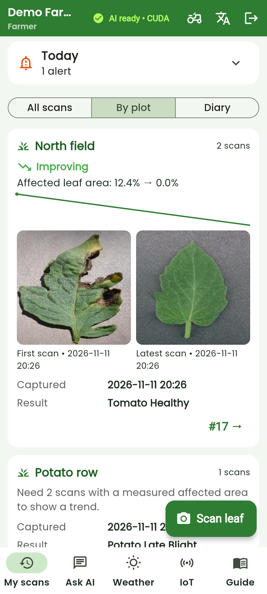<br><sub><b>Recovery</b>: first vs latest</sub></td>
</tr>
<tr>
<td align="center">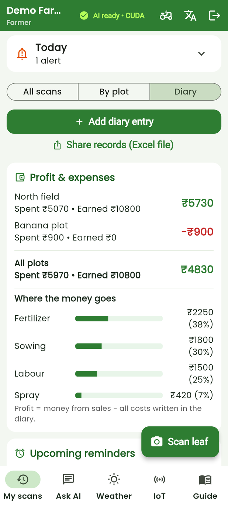<br><sub><b>Profit</b> & where money goes</sub></td>
<td align="center">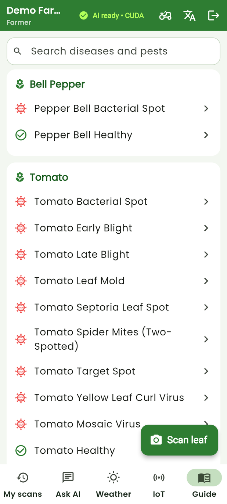<br><sub><b>Disease guide</b>, works offline</sub></td>
<td align="center">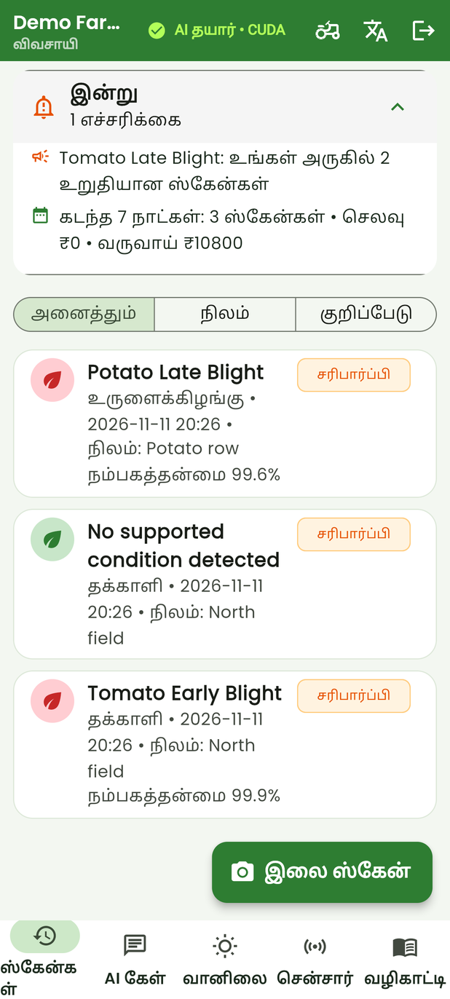<br><sub>Whole app in <b>Tamil</b></sub></td>
</tr>
</table>

<details>
<summary><b>🖥️ Farmer website</b> (same account as the app) — click to open</summary>
<br>
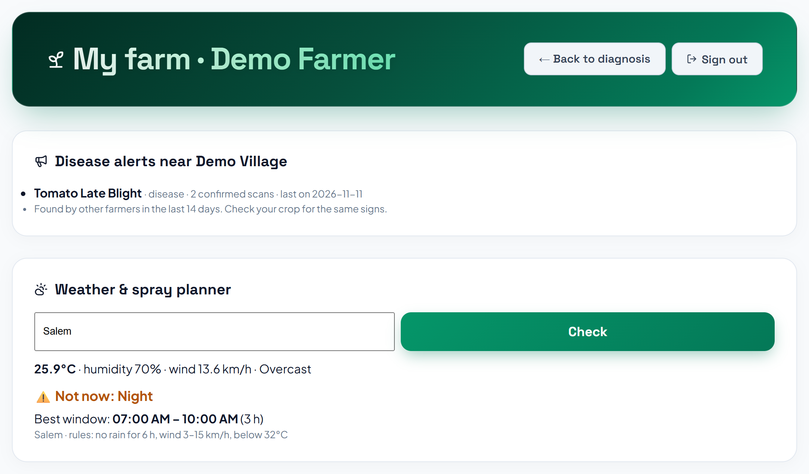
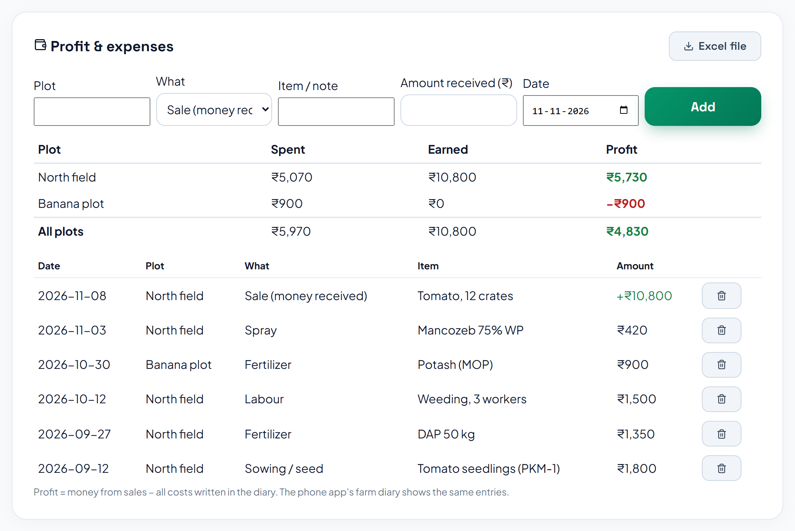
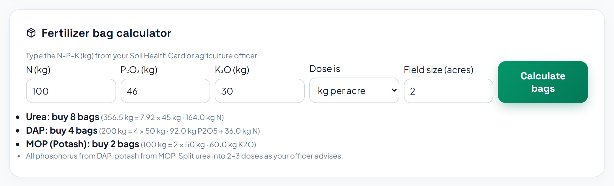
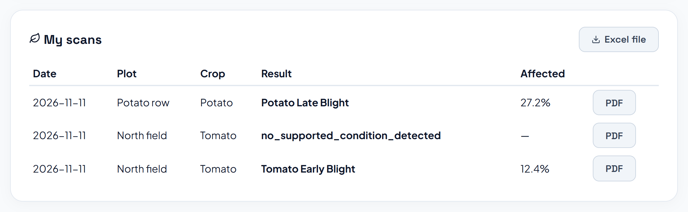
<p align="center">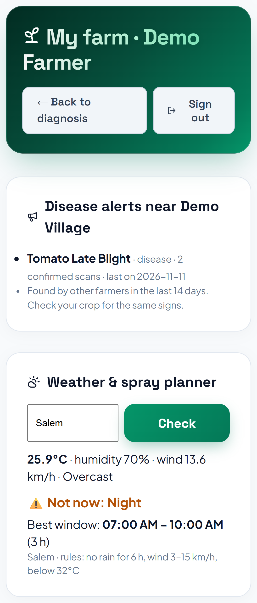</p>
</details>

## 🧠 How it works

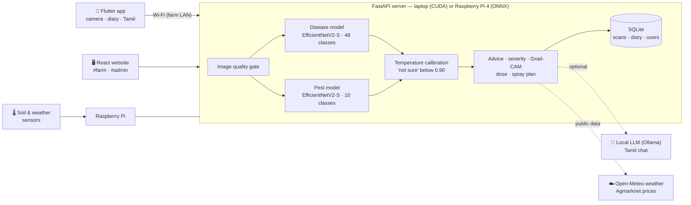

## 📊 Accuracy

Measured on **held-out photos the models never saw in training** (duplicates kept on one side of the split).

| Test | Result |
|---|---|
| Lab photos — tomato, potato, pepper | **99.71%** |
| Rice, banana and 11 more crops | **98.28%** |
| Pest model (9 pests + no pest) | **99.78%**, 0 false alarms on 534 pest-free leaves |
| Outdoor field photos (PlantDoc), full app | 60% correct · 25% "not sure" · 13% wrong |

> [!NOTE]
> Outdoor photos are the hard part for every leaf model. Treat a field result as a first opinion and confirm with the
> Kisan Call Centre (1800-180-1551) or your agriculture officer before spraying.

## 🚀 Quick start

**1 · Server (Windows laptop)**

```bat
SETUP_ALL.bat     :: Python venv, packages, website build, firewall rule
start.bat         :: server on http://<laptop-ip>:8000
```

From the [latest release](https://github.com/Achu226/agrobotai/releases/latest) put `disease_model.pt`,
`disease_classes.json` and `calibration.json` in `models/`. Copy `.env.example` to `.env`.

**2 · Phone** — install `AGROBOTAI.apk` from the release, then *Login → Change server → Find server on Wi-Fi*.

**3 · Raspberry Pi (optional)** — put `disease_model.onnx` + `disease_model.json` in `models/onnx/` and follow
[`edge/README.md`](edge/README.md). A scan takes about 4 seconds on a Pi 4.

<details>
<summary><b>Retrain the models</b></summary>

`scripts/download_leaf_datasets.py` → `scripts/build_extended_dataset.py` → `scripts/train_extended_model.py`
→ `scripts/compare_disease_models.py` (a new model must not lose accuracy on any earlier test set)
→ `scripts/calibrate_models.py` → `scripts/export_onnx.py`.
</details>

> [!IMPORTANT]
> The **pest model is not published**: the licence of its training photos is not confirmed. Without it the app says
> "pest model unavailable" and everything else works. Train your own with `run_training.py`.

## 🗂️ Project structure

| Folder | What |
|---|---|
| [`agrobot_flutter_app/`](agrobot_flutter_app) | Android app (Flutter) — 82 widget and unit tests |
| [`server.py`](server.py), [`src/`](src) | FastAPI server: models, calibration, advice, SQLite (`/api/v1`) |
| [`frontend/`](frontend) | Website (React + Vite): diagnosis, `#farm` farmer page, `#admin` dashboard |
| [`edge/`](edge) | Raspberry Pi 4 server (ONNX Runtime), install, deploy and auto-off |
| [`iot/`](iot) | Soil-moisture and weather sensor agent for the Pi |
| [`scripts/`](scripts) | Dataset build, training, calibration, evaluation, deploy |
| [`tests/`](tests) | Server tests (`pytest`, 170+) |

## 🗺️ Roadmap

- [ ] Garden plants (rose, money plant, hibiscus, marigold) — trained, held back until they stop hurting farm accuracy
- [ ] Model inside the phone for scans with no laptop or Pi nearby
- [ ] More languages for the app buttons (advice is already in 12)
- [ ] Retraining from farmers' own reviewed photos

## 🙋 Using AGROBOTAI?

College project, research, a farm or a terrace garden — [**tell us in one minute**](https://github.com/Achu226/agrobotai/issues/new?template=using-agrobotai.yml)
and ⭐ star the repo. Found a bug? [Open an issue](https://github.com/Achu226/agrobotai/issues/new?template=bug.yml).

## 📚 Datasets and credits

The models are trained on these public datasets (not included in this repository):

| Dataset | Licence |
|---|---|
| PlantVillage (Hughes & Salathé; `mohanty/PlantVillage`) | CC BY-SA 3.0 |
| PlantDoc (Singh et al., 2020) | CC BY 4.0 |
| Rice leaf diseases (Sethy et al., Mendeley 10.17632/fwcj7stb8r.2) | CC BY 4.0 |
| Rice (Bangladesh), BananaLSD (Mendeley 10.17632/9tb7k297ff.1), chilli, betel, turmeric — via Project-AgML | CC BY 4.0 |
| Beans (AI Lab Makerere) | MIT |

## 📄 Cite and licence

Use the **"Cite this repository"** button on the right ([`CITATION.cff`](CITATION.cff)).
Source code: [MIT](LICENSE) · model weights: **CC BY-SA 4.0** (trained on PlantVillage, CC BY-SA) · datasets: their own licences.

<p align="center"><sub>AGROBOTAI gives a first opinion, not a guarantee. Always read the pesticide label.</sub></p>
